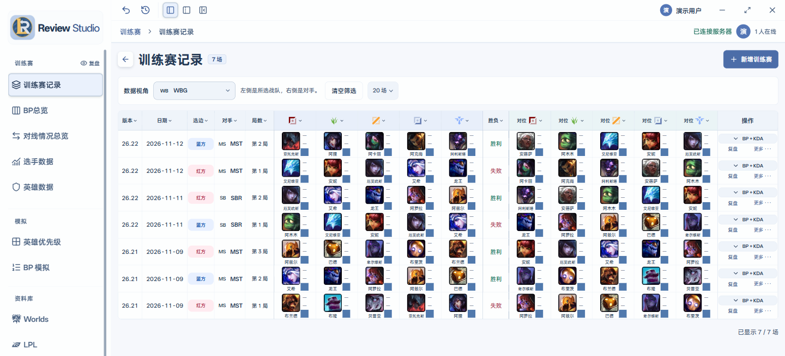
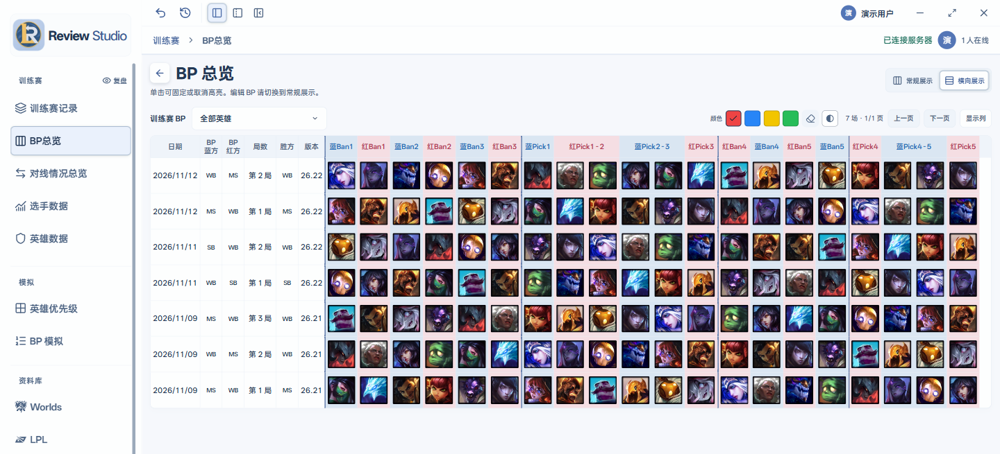
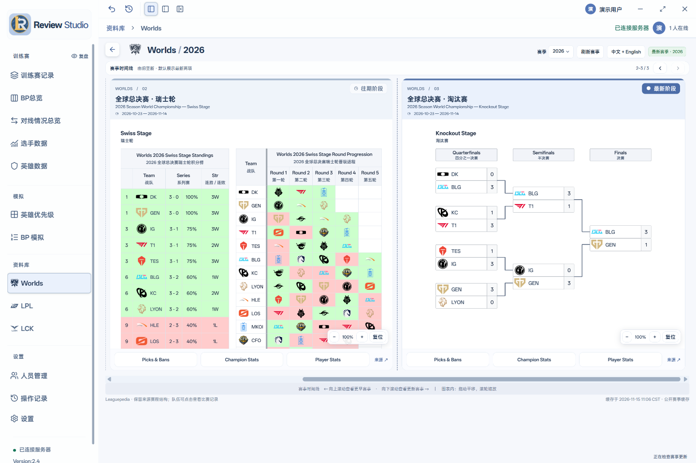

<h1 align="center">
  
</h1>

  作者 · <a href="https://github.com/MedusaFjd">MedusaFjd</a> · <a href="https://github.com/YuanWiz">YuanWiz</a>

  <strong>英雄联盟训练赛复盘与备战工具</strong> 
  记录训练赛、准备 BP、复盘对线与团战，查阅职业赛事的赛程、禁选和逐局数据。

  <a href="https://github.com/LOLDataStudio/review-studio-downloads/releases/latest"><strong>下载 Windows 正式版 2.4</strong></a>
   Windows x64 · 安装包约 133 MiB

  <a href="#功能图览">按功能查找</a> · <a href="#安装与使用">安装与使用</a> · <a href="CHANGELOG.md">更新日志</a> · <a href="#窗口操作">窗口操作</a>

## 最近更新

**正式版 2.4 · 2026-11-24**

- **训练赛记录**支持行内编辑和完整编辑，返回页面时恢复筛选、滚动位置与展开状态。
- **BP 模拟**支持跨阵营框选、复制粘贴和批量清除，撤回操作会先在本机显示结果。
- **资料库**的 Worlds、LPL、LCK 各自新增 Player Stats。逐局详情可查看按游戏槽位排列的符文和属性碎片，悬停显示中文名称。

[查看正式版更新日志](CHANGELOG.md)

## 功能图览

<table>
<thead><tr><th>分组</th><th>页面</th><th>页内入口</th></tr></thead>
<tbody>
<tr><th rowspan="4" scope="rowgroup" align="left" valign="top"><strong><a href="#%E8%AE%AD%E7%BB%83%E8%B5%9B">训练赛</a></strong></th><td><a href="#%E8%AE%AD%E7%BB%83%E8%B5%9B%E8%AE%B0%E5%BD%95">训练赛记录</a></td><td>选一局 → BP＋KDA、截图、复盘</td></tr>
<tr><td><a href="#bp-%E6%80%BB%E8%A7%88">BP 总览</a> · <a href="#%E5%AF%B9%E7%BA%BF%E6%83%85%E5%86%B5%E6%80%BB%E8%A7%88">对线情况总览</a></td><td>按日期比较禁选，或按分路查看对位</td></tr>
<tr><td><a href="#%E9%80%89%E6%89%8B%E6%95%B0%E6%8D%AE">选手数据</a> · <a href="#%E8%8B%B1%E9%9B%84%E6%95%B0%E6%8D%AE">英雄数据</a></td><td>选手档案、对位表现、全队与英雄胜率</td></tr>
<tr><td><a href="#%E8%B5%9B%E4%BA%8B%E5%A4%8D%E7%9B%98">赛事复盘</a></td><td><a href="#bp">BP</a> · <a href="#%E5%AF%B9%E7%BA%BF%E5%A4%8D%E7%9B%98">对线复盘</a> · <a href="#%E5%9B%A2%E9%98%9F%E4%BA%8B%E4%BB%B6">团队事件</a> · <a href="#%E7%BB%93%E6%9E%9C">结果</a> · <a href="#%E6%80%BB%E7%BB%93">总结</a></td></tr>
</tbody>
<tbody>
<tr><th rowspan="1" scope="rowgroup" align="left" valign="top"><strong><a href="#%E6%A8%A1%E6%8B%9F">模拟</a></strong></th><td><a href="#%E8%8B%B1%E9%9B%84%E4%BC%98%E5%85%88%E7%BA%A7">英雄优先级</a> · <a href="#bp-%E6%A8%A1%E6%8B%9F">BP 模拟</a></td><td>分路英雄池 → 各局禁选方案</td></tr>
</tbody>
<tbody>
<tr><th rowspan="1" scope="rowgroup" align="left" valign="top"><strong><a href="#%E8%B5%84%E6%96%99%E5%BA%93">资料库</a></strong></th><td><a href="#worldslpl-%E4%B8%8E-lck">Worlds、LPL、LCK</a></td><td>赛段 → <a href="#%E5%85%AC%E5%BC%80%E8%B5%9B%E4%BA%8B%E7%A6%81%E9%80%89%E4%B8%8E%E8%8B%B1%E9%9B%84%E7%BB%9F%E8%AE%A1">禁选与英雄统计</a> · <a href="#选手统计与逐局数据">选手统计与逐局详情</a>。战队 → <a href="#%E6%88%98%E9%98%9F%E6%AF%94%E8%B5%9B%E5%8E%86%E5%8F%B2">比赛历史</a></td></tr>
</tbody>
<tbody>
<tr><th rowspan="2" scope="rowgroup" align="left" valign="top"><strong><a href="#%E8%AE%BE%E7%BD%AE">设置</a></strong></th><td><a href="#%E8%AE%BE%E7%BD%AE%E9%A1%B5">设置页</a></td><td><a href="#%E4%B8%AA%E4%BA%BA%E4%BF%A1%E6%81%AF%E4%B8%8E%E7%95%8C%E9%9D%A2%E5%A4%96%E8%A7%82">个人信息与界面外观</a> · <a href="#%E5%9F%BA%E7%A1%80%E8%B5%84%E6%96%99%E5%BA%93">基础资料库</a></td></tr>
<tr><td><a href="#%E4%BA%BA%E5%91%98%E7%AE%A1%E7%90%86">人员管理</a> · <a href="#%E6%93%8D%E4%BD%9C%E8%AE%B0%E5%BD%95">操作记录</a></td><td>全部成员、入队申请、修改对照与恢复</td></tr>
</tbody>
</table>

## 训练赛

### 训练赛记录

在「数据视角」选战队，左侧看本队、右侧看对手。按版本、日期、选边、对手或胜负找比赛。新增或编辑一行可以填写局数、双方阵容和对位结果。展开 **BP＋KDA** 后，左边看禁选顺序，中间逐位置对照选手、英雄与 K/D/A，右边可以选择或粘贴该局截图，双击查看原图。行内「复盘」打开这场比赛。

双击本场截图打开原图后，可以选择「原始大小（100%）」查看细节，也可以选「适应窗口」看全图。需要补录整场资料时，进入复盘页的[编辑训练赛](#编辑训练赛)。

*训练赛与 BP 总览截图使用演示数据。*

### BP 总览

按日期在同一屏回看多局 BP，双击日期可编辑当天备注。「常规展示」可点 Ban 或 Pick 格修改实际训练赛的禁选。「横向展示」把多局排成表格，可筛选英雄、选择显示列、点击固定英雄高亮，方便找出连续几局重复出现的选择。

查看 BP 总览截图

### 对线情况总览

选择上路、中路或双人路，按战队、英雄和日期筛选对线记录。每行并列展示双方对线英雄和打野、比赛胜负及对位评价。展开一行，可在「展示对线」和「展示团队」之间切换，回看这场比赛对应的事件时间轴。英雄对线详情使用相同视图并限定所选英雄。

在支持的英雄头像上停留会打开统计浮窗，列出胜负、胜率、KDA 及近期对局。可调整场次范围，有选手上下文时还能切换「当前选手／全部数据」。点「显示英雄对线总览」继续查看该英雄的对位记录。

### 选手数据

从「训练赛 → 选手数据」选择战队、位置和选手，再按版本、日期或最近 10 场、20 场、全部训练赛限定样本。

| 栏目 | 怎样读 |
| --- | --- |
| 选手档案 | 核对所属战队和常用位置，查看当前范围内的场次、胜率、对位优势率和使用英雄数。 |
| 最近训练赛 · 对位表现 | 沿比赛顺序看对位评分起伏，找到需要回看的场次。 |
| 对位结果分布 | 比较已有评价的优势、均势和劣势场次，与整场胜负分开看。 |
| 英雄表现与使用分布 | 按英雄比较出场、胜负、平均 K/D/A 和对位结果。从英雄记录可查看相关训练赛，再打开具体复盘。 |

### 英雄数据

「全队胜率」按版本比较战队整体成绩。下方英雄表可以按战队、位置、版本和「只看第一局」缩小范围，查看 Ban、Pick、BP 率、胜率、平均 K/D/A、一选率、Counter 率和平均对位。点表头可排序，「添加关注英雄」可以把尚未出场的英雄也放进观察名单。

### 赛事复盘

从一行训练赛进入会打开指定对局。侧栏的「赛事复盘」优先恢复上次查看的比赛。训练赛分组标题旁的「复盘」可显示或收起侧栏入口。

#### BP

对照实际禁选顺序，修改 Ban、Pick 并点击「保存 BP」，写回这场训练赛。

#### 对线复盘

在上路、中路、双人路之间切换，查看前 20 分钟的时间轴。可新增时间点或时间段，标记事件、视角、优劣势与说明。团队事件也会出现在对应时间段。

#### 团队事件

在整场比赛的时间轴上记录小龙、资源争夺等事件。拖动标注调整时间，在下方「事件详情」查看、编辑或删除记录。

#### 结果

查看比赛胜负、双方阵容和已导入的资源记录。需要改 KDA 时，从页头打开「编辑训练赛」。

#### 总结

为本局写下做得好的地方和下一场要调整的内容，保存后可回来继续复盘。

#### 编辑训练赛

从复盘页右上角进入。五个步骤共用同一场比赛的资料。

| 编辑页签 | 填写内容 |
| --- | --- |
| 基本信息 | 日期、赛季、版本、局数、对手、选边、比赛结果和时长。 |
| 双方阵容 | 按位置填写双方选手、英雄和 K/D/A。尚无击杀、死亡或助攻数据时可以留空。 |
| 召唤师技能与符文 | 为对局中的选手补录召唤师技能和基石符文。 |
| BP（可选） | 按实际出手顺序补录本局禁选。 |
| 确认保存 | 核对对阵和双方阵容，填写备注，再点「保存并复盘」。 |

[返回功能图览](#功能图览)

## 模拟

### 英雄优先级

在侧栏「模拟」选择「英雄优先级」，选定英雄池所属战队。按上、野、中、下、辅添加英雄，拖动调整顺序，右键标记优先级、我方绝活、敌方绝活或已使用。不同备战方案可以分工作页保存，支持新增、重命名和删除页。「保存英雄池」保留当前页的阵容、顺序和标记，「恢复英雄池」回到该页上次保存的内容。

### BP 模拟

一个模拟页可以放多局 BP 盘，每局独立设置队伍、蓝红方和方案名。输入英雄全名或别名可选人，按禁选顺序安排首选和备选。「BP 思路与备注」分前三个 Pick、后两个 Pick 两个阶段，各自记录预案。

拖选英雄格后用 **Ctrl+C / Ctrl+V** 复制选区。可从目标左上角跨阵营粘贴，选区中的空格也会覆盖目标。「批量粘贴」可选择目标页和目标盘。整盘复制仅包含 BP 格。打印时可勾选需要的对局，每局单独一页。

[返回功能图览](#功能图览)

## 资料库

### Worlds、LPL 与 LCK

| 资料库入口 | 在页面里看什么 |
| --- | --- |
| **Worlds** | 按赛季浏览全球总决赛各阶段，例如瑞士轮的战绩和淘汰赛的晋级路线。 |
| **LPL** | 沿赛事时间线查看已收录的联赛阶段与资格赛，在赛段卡片中看对阵、比分和晋级关系。 |
| **LCK** | 按赛季查看韩国联赛的阶段、赛程与赛果，在相应卡片打开该赛段的详细资料。 |

三个入口共用赛季选择、往期与最新阶段切换、赛事刷新和中英显示。赛事图可缩放、拖动和复位。点图中的战队可查看比赛历史。赛段卡片底部可以进入已提供的禁选和统计页。覆盖局数随已收录资料变化。

查看 Worlds 赛程截图

#### 公开赛事禁选与英雄统计

- **Picks & Bans · 常规展示** 按系列赛和局数查看蓝红双方禁选。可以筛选英雄和队伍，展开单局，或用「展开本页／收起本页」批量查看卡片。
- **Picks & Bans · 横向展示** 把多局排成对照表，在「显示列」选择要看的字段。可以用高亮标记英雄，比较其在不同对局的选禁位置。
- **Champion Stats** 按赛段、队伍、位置、选手和英雄筛选。用场次、禁选率、胜负、KDA、经济或伤害等列比较英雄，再从可点击的场次或选手查看明细。

#### 选手统计与逐局数据

| 页面或详情 | 可以做什么 |
| --- | --- |
| **Player Stats · 赛段选手统计** | 从 Worlds、LPL 或 LCK 的赛段卡片进入，按位置、队伍和选手汇总有完整计分板的对局。比较场次、胜率、KDA、补刀、视野、经济、伤害、参团率和英雄数。点击 **G（场次）** 打开该选手在当前范围内的逐局记录。 |
| **选手全年英雄统计** | 从比赛历史点击已有逐局资料的选手，查看该赛季用过哪些英雄、出场多少次和胜率。赛事和赛段筛选可进一步缩小范围。 |
| **逐局详情与 By 明细** | 在逐局表里查看日期、版本、选边、对位英雄、阵容、技能和装备等已收录字段。英雄统计的 **By** 可查看使用该英雄的选手。从可点击的选手 ID 可继续看同一赛事范围内的对局。 |

#### 战队比赛历史

点赛程或禁选页中的战队，进入该队的「比赛历史」。表格分为「基本信息」「英雄」「当局选手」三组。从日期、版本、胜负、选边和对手定位一局，再对照双方 Ban、Pick 与阵容。可用「当局选手」表头切换整表的本方或对方阵容，悬停英雄时同页的同一英雄会一起高亮。

[返回功能图览](#功能图览)

## 设置

### 设置页

从侧栏底部的齿轮进入。

#### 登录与加入团队

在「设置 → 个人信息」登录，或注册账号并选择申请加入的团队。提交后可查看待审批状态，获批后按账号权限访问团队训练赛、BP 和统计。未登录时可查看公共资料。

#### 个人信息与界面外观

| 入口或栏目 | 可以做什么 |
| --- | --- |
| **个人信息** | 登录后维护显示名称、头像和密码，或退出登录。上传图片后可拖动和缩放裁切头像。也可直接点击标题栏头像或用户名。 |
| **页面与表格** | 选择等比缩放或原尺寸、固定或手动侧栏宽度、滚动停止后显示表头或一直显示。可设重新进入页面时每次重置、离开 30 秒后重置或在本窗口保留，并选择赛事图按内容宽度适配或使用原有布局。 |
| **团队工作空间与团队数据** | 查看当前所在的空间。软件管理员可在获授权的团队与公共资料间切换。在线团队数据按账号权限从服务器读取。断线且有未提交编辑时，可从同步提示导出未提交的修改。 |

#### 基础资料库

在线版从「设置」右上方进入这三页。资料由有相应权限的管理员维护。

| 页面 | 栏目与操作 |
| --- | --- |
| **英雄库** | 按分路或中文、英文、韩文、拼音、首字母、昵称搜索。悬停英雄头像可看最近训练赛表现。有权限时可维护英雄资料和别名，供训练赛与 BP 录入时匹配。 |
| **战队选手库** | 在「战队」按赛区选队，再查该队各位置的选手。管理员可维护战队名称、简称、队标，以及选手姓名、头像和一个或多个位置。 |
| **召唤师技能及符文** | 「召唤师技能」和「基石符文」分开展示名称与图标。有权限时可新增条目，双击卡片编辑标准名称、别名和图标。 |

### 人员管理

#### 全部成员

团队管理员查看本团队，软件管理员可查看全部团队。按姓名、账号或战队查成员，查看角色、启用状态及是否在线。软件管理员还有创建用户和权限管理记录入口。

#### 入队申请

管理员查看待审批申请、申请加入的团队，决定批准或拒绝。

### 操作记录

管理员按权限查看操作人、时间和修改对象。「展开快照」看当时内容，「查看对照」比较修改前后。允许恢复的条目提供「恢复」。有后续编辑冲突时会保留当前内容。删除记录只移除该条日志。

登录成员可用标题栏「撤回自己的修改」撤回本人在当前页面的编辑。管理员的「编辑记录」通往操作记录。顶部状态区会区分正在同步、正在重连和连接中断，待审批提醒可直接进入人员管理。

[返回功能图览](#功能图览)

## 窗口操作

标题栏可以切换完整侧栏、仅图标或隐藏侧栏。左上角返回按钮与鼠标后退侧键可返回上一层。从逐局详情返回后会保留筛选结果。

### 独立页面窗口

右键侧栏入口，选择「在新窗口打开」。例如在主窗口做复盘，同时让独立窗口停在选手数据页，核对对位和英雄表现。窗口可以各自浏览页面。

## 安装与使用

1. 从[正式版发布页](https://github.com/LOLDataStudio/review-studio-downloads/releases/latest)的 **Assets** 下载 Windows x64 安装包 `ReviewStudio-Formal-2.4-Online-20261124.exe`，运行安装。
2. 首次使用需要联网。未登录时可浏览公开赛事资料。登录并加入团队后，按权限查看或编辑该团队的训练赛、BP 和统计。
3. 覆盖升级时，先退出程序，再选择原有的正式版安装目录，以保留已有本机数据。
