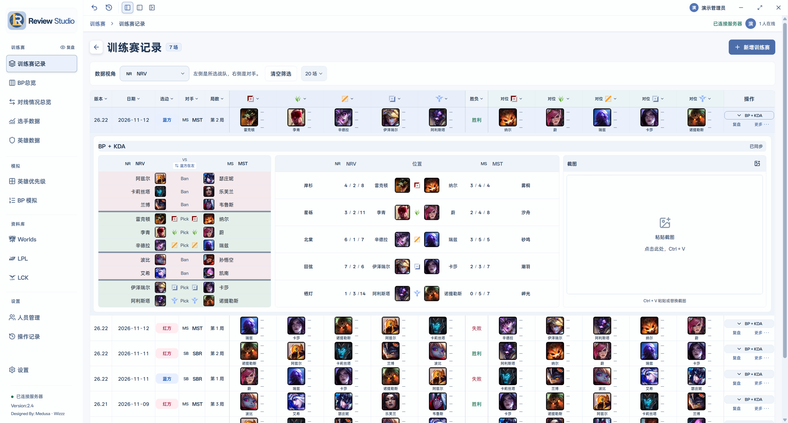
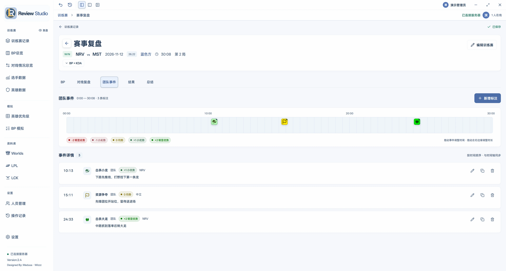
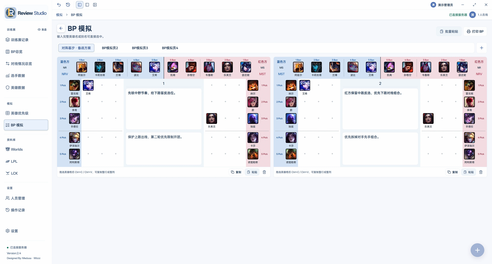
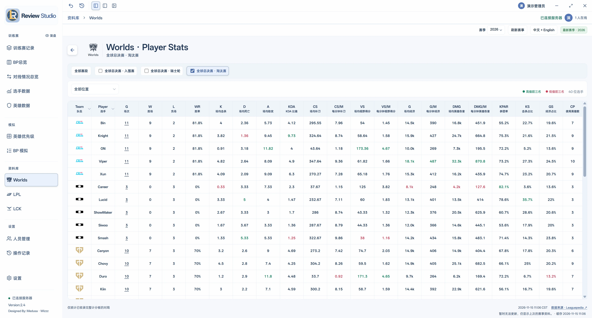

<h1 align="center">
  
</h1>

  作者 · <a href="https://github.com/MedusaFjd">MedusaFjd</a> · <a href="https://github.com/YuanWiz">YuanWiz</a>

<strong>英雄联盟训练赛复盘与备战工具</strong> 
Review Studio 是一款用来记训练赛、复盘和准备 BP 的英雄联盟桌面软件。你可以和队友一起整理训练赛和备战资料，也能查 Worlds、LPL、LCK 的赛程、每局禁选和统计。

## 下载与安装

[**下载正式版 2.4（Windows x64）**](https://github.com/LOLDataStudio/review-studio-downloads/releases/latest) · [正式版更新日志](CHANGELOG.md)

在发布页的 **Assets** 下载 `ReviewStudio-Formal-2.4-Online-20261124.exe` 并安装。

第一次打开时要联网。升级前先备份本机数据、退出软件，再安装到原正式版的安装目录。这样可以保留已有数据和配置。

[训练赛与复盘](#训练赛与复盘) · [英雄池与 BP 模拟](#英雄池与-bp-模拟) · [选手与英雄数据](#选手与英雄数据) · [职业赛事资料](#职业赛事资料) · [团队协作](#团队协作)

## 训练赛与复盘

在「训练赛记录」按日期、版本、对手、选边或胜负找比赛。新增或修改一行时，可以填局数、双方阵容和对位结果。点 **BP＋KDA** 看禁选顺序，按位置对照双方选手、英雄和 K/D/A。截图能从右侧选取或粘贴，双击就能看原图。

本页截图来自正式版 2.4，训练赛使用演示数据。

点比赛行里的「复盘」，就能接着看这一局。对线页可以切换上路、中路和双人路，在前 20 分钟的时间轴上记某个时点或一段时间内发生的事。控龙、资源争夺等全场事件记在团队时间轴，拖动标注就能改时间。复盘时也可以查看比赛结果，写下总结。

想看看几局都选了什么，就到「BP 总览」按日期找比赛。在「常规展示」点 Ban 或 Pick 格可以改实际记录，切到「横向展示」则能筛英雄、选列和固定高亮。

## 英雄池与 BP 模拟

到「英雄优先级」选队，再按分路加英雄。拖动能改顺序，右键可以标记我方或敌方绝活，也能标成已使用。不同方案可以分开存，一页改乱了也能恢复到上次保存的内容。

「BP 模拟」一页能排好几局。每局各自选队、设蓝红方和方案名，再按顺序排禁选和备选。前三个 Pick 和后两个 Pick 可以分别写预案。要复用英雄就复制选区，需要打印时只勾选要打的局，一局一页。

## 选手与英雄数据

- **对线情况总览**｜先选上路、中路或双人路，再按战队、英雄和日期找对线记录。表里能对照双方的对线英雄和打野，也能看胜负和对位评价。展开一行，就能回看那局的时间轴。
- **选手数据**｜选定战队、位置和选手后，用版本、日期或场次缩小范围。看这名选手的出场、胜率、对位和用过的英雄。点对应的英雄记录，还能找到那些训练赛。
- **英雄数据**｜这一页能看全队胜率，也能按英雄看 Ban、Pick、BP 率、胜率和平均 K/D/A。可以按战队、分路或版本筛选，也能只看第一局。

## 职业赛事资料

到「资料库」选 Worlds、LPL 或 LCK，按赛季查赛程、比分和晋级路线。点战队还能回看比赛历史，对照双方阵容、胜负、选边和禁选。

Picks & Bans 里既可以顺着系列赛看每一局，也能把几局排到同一张表。筛选英雄或队伍，再高亮一个英雄，就能看它在哪些位置被选或禁用。

用 Champion Stats 查英雄出场、禁选率、胜率和 KDA。想看选手，就去 Player Stats 按位置、队伍或选手筛选有完整计分板的对局。点场次能打开逐局详情，查看对位、阵容和装备。

## 团队协作

没登录也能查公开赛事。登录或注册后申请入队，通过后就能按权限看或改本队的训练赛、BP 和统计。管理员可以查成员、审批申请，也可以在操作记录里查谁改了什么，查看改动前后的内容。符合条件的记录可以恢复。

复盘时可以让主窗口停在时间轴，另开一个窗口核对选手的对位结果。右键侧栏入口，选「在新窗口打开」即可。

## 最近更新

**正式版 2.4 · 2026-11-24**

- **训练赛记录**｜已保存的比赛可以行内编辑，也可以打开完整编辑页。返回列表时恢复筛选、滚动位置和展开状态。
- **BP 模拟**｜支持跨阵营框选、复制粘贴和批量清除，撤回时先在本机显示结果。
- **资料库**｜Worlds、LPL 和 LCK 都增加了 Player Stats。逐局详情按槽位列出符文和属性碎片，悬停可看中文名。

[查看历次正式版更新](CHANGELOG.md)

## 使用指南

详细操作、各页面的完整截图和设置说明见[使用指南](USER-GUIDE.md)。
