

<h1 align="center">
  
</h1>

  作者 · <a href="https://github.com/MedusaFjd">MedusaFjd</a> · <a href="https://github.com/YuanWiz">YuanWiz</a>

  <strong>英雄联盟训练赛复盘与备战工具</strong> 
  用它记训练赛、准备 BP、复盘对线和团战，也能查职业赛事的赛程、禁选和逐局数据。

  <a href="https://github.com/LOLDataStudio/review-studio-downloads/releases/latest"><strong>下载正式版 2.5</strong></a>
   Windows x64

  <a href="#功能图览">按功能查找</a> · <a href="#交互动效">看动效</a>
  · <a href="#安装与使用">安装与使用</a> · <a href="#数据与升级">数据与升级</a>
   
  <a href="CHANGELOG.md">正式版更新日志</a>

---

**使用指南** · [返回项目介绍](README.md)

## 最近更新

**正式版 2.5 · 2026-11-26**

- **训练赛记录**可按五路多选对手选手，从「胜负」表头查看当前筛选范围内的总场数和胜率。
- **英雄优先级**可在英雄池右侧查看本队训练赛数据。英雄池支持竖版 A4 预览，BP 模拟支持选中对局的横版 A4 预览。
- **资料库**的阵容筛选按五路排列，赛事英雄统计恢复位置滑块动画。

[查看正式版更新日志](CHANGELOG.md)

## 功能图览

<table>
<thead><tr><th>分组</th><th>页面</th><th>页内入口</th></tr></thead>
<tbody>
<tr><th rowspan="4" scope="rowgroup" align="left" valign="top"><strong><a href="#%E8%AE%AD%E7%BB%83%E8%B5%9B">训练赛</a></strong></th><td><a href="#%E8%AE%AD%E7%BB%83%E8%B5%9B%E8%AE%B0%E5%BD%95">训练赛记录</a></td><td>选一局 → BP＋KDA、截图、复盘</td></tr>
<tr><td><a href="#bp-%E6%80%BB%E8%A7%88">BP 总览</a> · <a href="#%E5%AF%B9%E7%BA%BF%E6%83%85%E5%86%B5%E6%80%BB%E8%A7%88">对线情况总览</a></td><td>按日期比较禁选，或按分路查看对位</td></tr>
<tr><td><a href="#%E9%80%89%E6%89%8B%E6%95%B0%E6%8D%AE">选手数据</a> · <a href="#%E8%8B%B1%E9%9B%84%E6%95%B0%E6%8D%AE">英雄数据</a></td><td>选手档案、对位表现、全队与英雄胜率</td></tr>
<tr><td><a href="#%E8%B5%9B%E4%BA%8B%E5%A4%8D%E7%9B%98">赛事复盘</a></td><td><a href="#bp">BP</a> · <a href="#%E5%AF%B9%E7%BA%BF%E5%A4%8D%E7%9B%98">对线复盘</a> · <a href="#%E5%9B%A2%E9%98%9F%E4%BA%8B%E4%BB%B6">团队事件</a> · <a href="#%E7%BB%93%E6%9E%9C">结果</a> · <a href="#%E6%80%BB%E7%BB%93">总结</a></td></tr>
</tbody>
<tbody>
<tr><th rowspan="1" scope="rowgroup" align="left" valign="top"><strong><a href="#%E6%A8%A1%E6%8B%9F">模拟</a></strong></th><td><a href="#%E8%8B%B1%E9%9B%84%E4%BC%98%E5%85%88%E7%BA%A7">英雄优先级</a> · <a href="#bp-%E6%A8%A1%E6%8B%9F">BP 模拟</a></td><td>分路英雄池 → 各局禁选方案</td></tr>
</tbody>
<tbody>
<tr><th rowspan="1" scope="rowgroup" align="left" valign="top"><strong><a href="#%E8%B5%84%E6%96%99%E5%BA%93">资料库</a></strong></th><td><a href="#worldslpl-%E4%B8%8E-lck">Worlds、LPL、LCK</a></td><td>赛段 → <a href="#%E5%85%AC%E5%BC%80%E8%B5%9B%E4%BA%8B%E7%A6%81%E9%80%89%E4%B8%8E%E8%8B%B1%E9%9B%84%E7%BB%9F%E8%AE%A1">禁选与英雄统计</a> · <a href="#players-%E4%B8%8E%E9%80%90%E5%B1%80%E6%95%B0%E6%8D%AE">选手统计与逐局详情</a>。战队 → <a href="#%E6%88%98%E9%98%9F%E6%AF%94%E8%B5%9B%E5%8E%86%E5%8F%B2">比赛历史</a></td></tr>
</tbody>
<tbody>
<tr><th rowspan="2" scope="rowgroup" align="left" valign="top"><strong><a href="#%E8%AE%BE%E7%BD%AE">设置</a></strong></th><td><a href="#%E8%AE%BE%E7%BD%AE%E9%A1%B5">设置页</a></td><td><a href="#%E4%B8%AA%E4%BA%BA%E4%BF%A1%E6%81%AF%E4%B8%8E%E7%95%8C%E9%9D%A2%E5%A4%96%E8%A7%82">个人信息与界面外观</a> · <a href="#%E5%9F%BA%E7%A1%80%E8%B5%84%E6%96%99%E5%BA%93">基础资料库</a></td></tr>
<tr><td><a href="#%E4%BA%BA%E5%91%98%E7%AE%A1%E7%90%86">人员管理</a> · <a href="#%E6%93%8D%E4%BD%9C%E8%AE%B0%E5%BD%95">操作记录</a></td><td>全部成员、入队申请、修改对照与恢复</td></tr>
</tbody>
</table>

[下载安装](#安装与使用) · [交互动效](#交互动效) · [窗口操作](#窗口操作) · [数据与升级](#数据与升级)

截图和动图来自 Windows 正式版 2.4，团队页面用的是演示数据。点击截图查看原图。

## 训练赛

<picture>
  <source media="(prefers-reduced-motion: reduce) and (max-width: 640px)" srcset="assets/guide/training-review-compact-still.webp">
  <source media="(prefers-reduced-motion: reduce)" srcset="assets/guide/training-review-still.webp">
  <source media="(max-width: 640px)" srcset="assets/guide/training-review-compact.gif">
  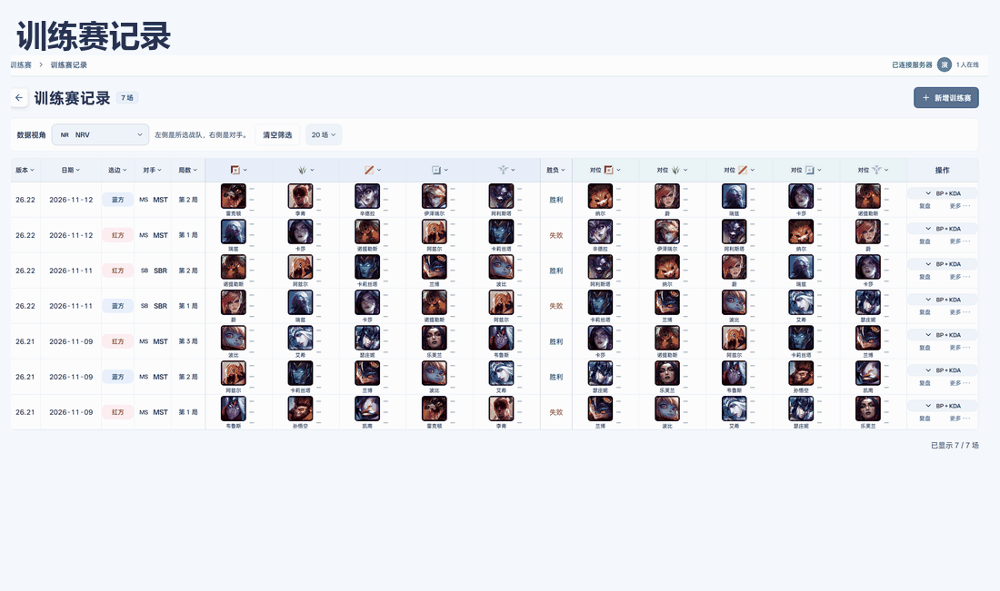
</picture>

[训练赛列表原图](assets/match-list.webp) · [展开 BP＋KDA](assets/training-match-demo.png) · [复盘时间轴](assets/match-review.webp)

### 训练赛记录

在「数据视角」选战队，左边是本队，右边是对手。按版本、日期、选边、对手或胜负筛选。新增或编辑一行时，可以填局数、双方阵容和对位结果。点 **BP＋KDA**，左边看禁选顺序，中间按位置对照选手、英雄和 K/D/A，右边选取或粘贴截图。双击截图看原图，点「复盘」打开这一局。

打开原图后，选「原始大小（100%）」看细节，选「适应窗口」看全图。要补录整场资料，点复盘页的[编辑训练赛](#编辑训练赛)。

<strong>训练赛列表、录入与单局详情</strong>（3 张截图）

**训练赛列表**

[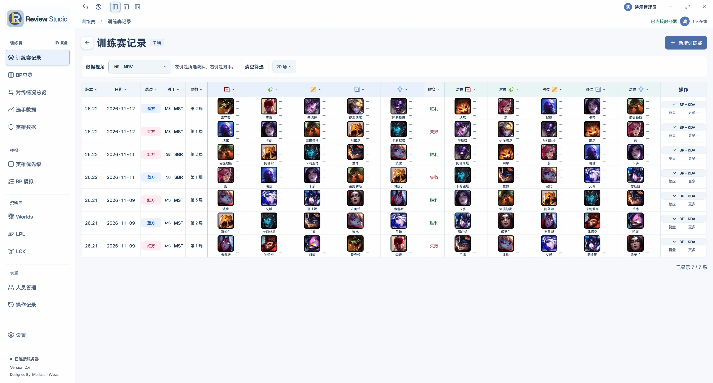](assets/match-list.webp)

**新增训练赛**

[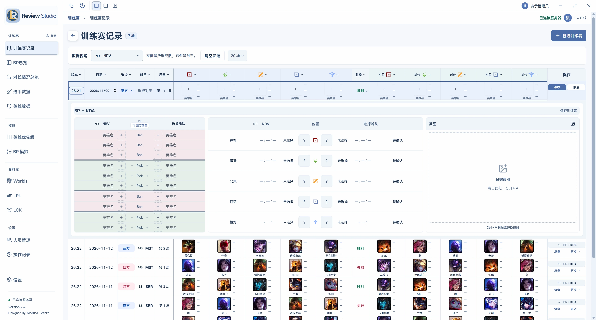](assets/match-entry.webp)

**单局 BP＋KDA**

[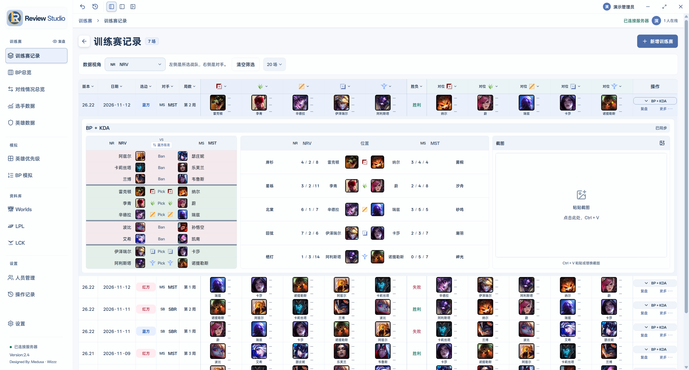](assets/training-match-demo.png)

### BP 总览

在同一屏按日期看多局 BP，双击日期可改当天备注。在「常规展示」点 Ban 或 Pick 格，可以改这场训练赛的禁选。切到「横向展示」，可以选显示列、筛英雄，点一下固定高亮，找出连续几局都出现的选择。

<strong>BP 总览</strong>（1 张截图）

[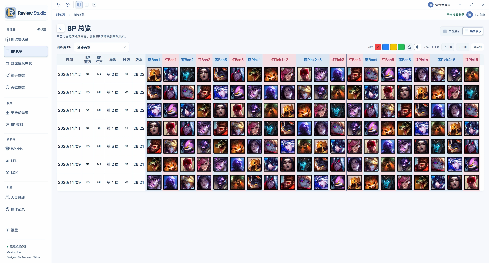](assets/bp-overview.webp)

### 对线情况总览

选上路、中路或双人路，再按战队、英雄和日期筛选。每行显示双方对线英雄、打野、比赛胜负和对位评价。展开一行，在「展示对线」和「展示团队」之间切换，就能看相应的事件时间轴。英雄对线详情用同一张表，只显示所选英雄的记录。

鼠标停在支持的英雄头像上，就能看胜负、胜率、KDA 和近期对局。可以改场次范围。有选手信息时，还能切换「当前选手／全部数据」。点「显示英雄对线总览」看这个英雄的对位记录。

<strong>对线情况总览</strong>（1 张截图）

[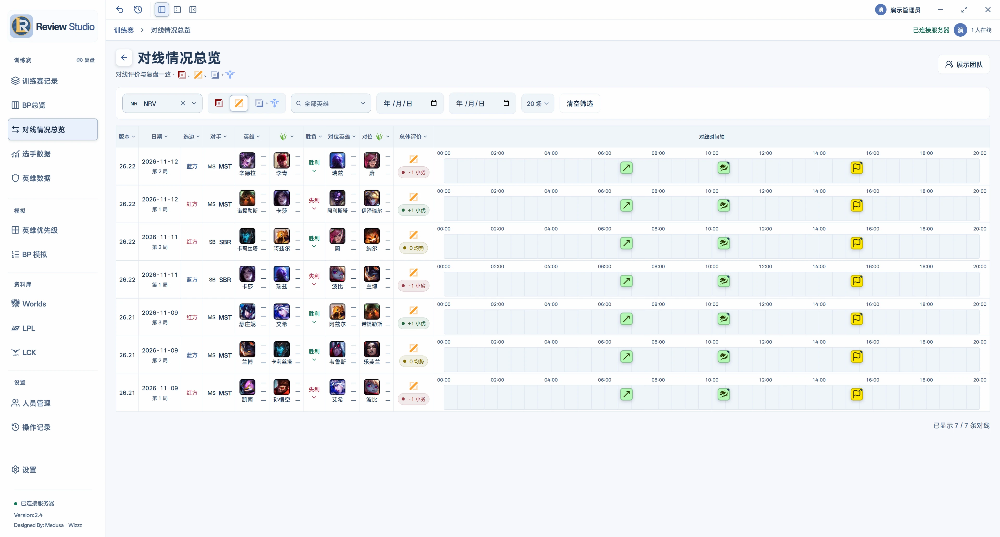](assets/lane-overview.webp)

### 选手数据

打开「训练赛 → 选手数据」，选战队、位置和选手。可以按版本、日期或场次筛选，场次有最近 10 场、20 场和全部训练赛。

| 栏目 | 怎样读 |
| --- | --- |
| 选手档案 | 看选手所属战队、常用位置，以及所选范围内的场次、胜率、对位优势率和使用英雄数。 |
| 最近训练赛 · 对位表现 | 按比赛顺序看对位评分，找出想回看的场次。 |
| 对位结果分布 | 比较已有评价的优势、均势和劣势场次，与整场胜负分开看。 |
| 英雄表现与使用分布 | 按英雄看出场、胜负、平均 K/D/A 和对位结果。点英雄记录，找到对应训练赛，再打开那一局复盘。 |

<a href="assets/player-stats.webp">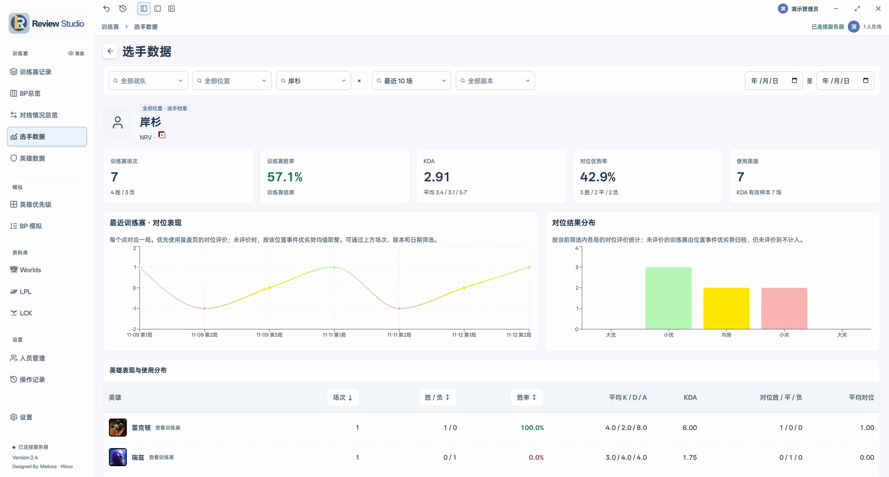</a>

### 英雄数据

在「全队胜率」按版本看战队成绩。英雄表可按战队、位置、版本筛选，也可勾选「只看第一局」。表里有 Ban、Pick、BP 率、胜率、平均 K/D/A、一选率、Counter 率和平均对位，点表头就能排序。用「添加关注英雄」也能关注还没出场的英雄。

<strong>英雄数据表</strong>（1 张截图）

[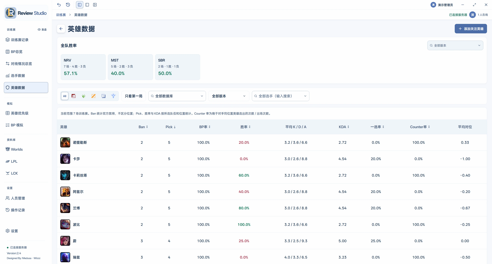](assets/win-rates.webp)

### 赛事复盘

点一行训练赛的「复盘」，会打开那一局。从侧栏打开「赛事复盘」，会优先回到上次看的比赛。点训练赛分组标题旁的「复盘」，可以显示或收起侧栏入口。

<picture>
  <source media="(prefers-color-scheme: dark) and (max-width: 640px)" srcset="assets/guide/review-navigation-night-compact.png">
  <source media="(prefers-color-scheme: dark)" srcset="assets/guide/review-navigation-night.png">
  <source media="(max-width: 640px)" srcset="assets/guide/review-navigation-compact.png">
  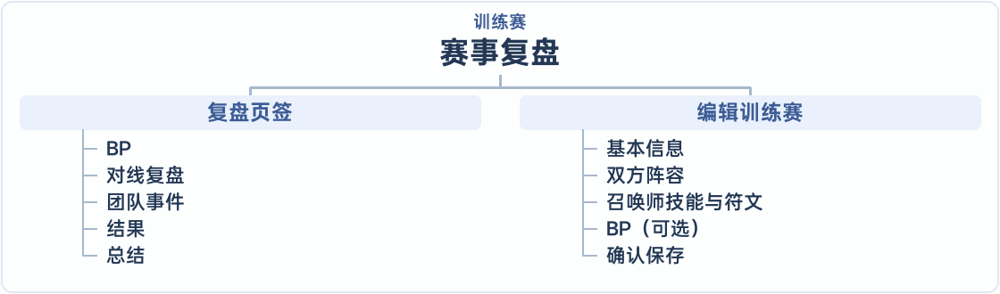
</picture>

#### BP

按实际禁选顺序改 Ban 和 Pick。点「保存 BP」后，改动会写回这场训练赛。

<strong>BP 页签</strong>（1 张截图）

[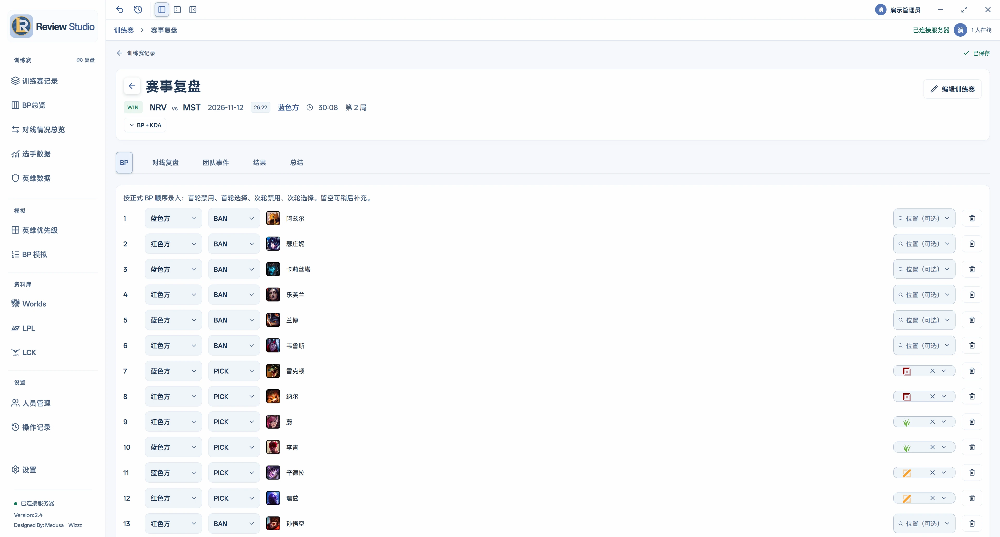](assets/guide/review-draft.webp)

#### 对线复盘

切换上路、中路或双人路，看前 20 分钟的时间轴。可以添加时间点或时间段，记录事件、视角、优劣势和说明。相同时段的团队事件也会显示在轴上。

<strong>对线复盘页签</strong>（1 张截图）

[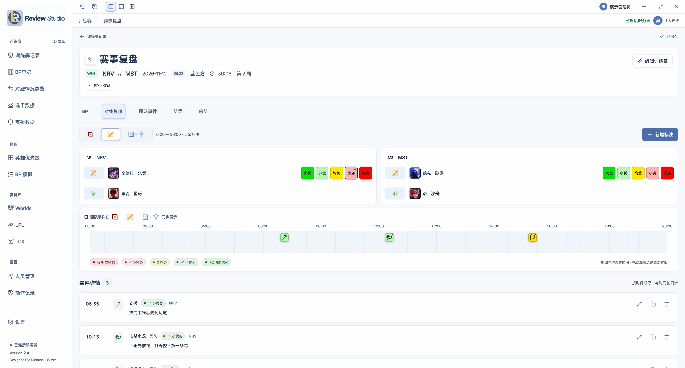](assets/guide/review-lanes.webp)

#### 团队事件

在整场比赛的时间轴上记录小龙、资源争夺等事件。拖动标注可以改时间。在下方「事件详情」查看、编辑或删除记录。

<strong>团队事件页签</strong>（1 张截图）

[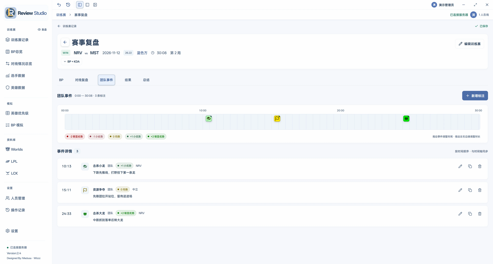](assets/match-review.webp)

#### 结果

查看比赛胜负、双方阵容和已导入的资源记录。需要改 KDA 时，从页头打开「编辑训练赛」。

<strong>结果页签</strong>（1 张截图）

[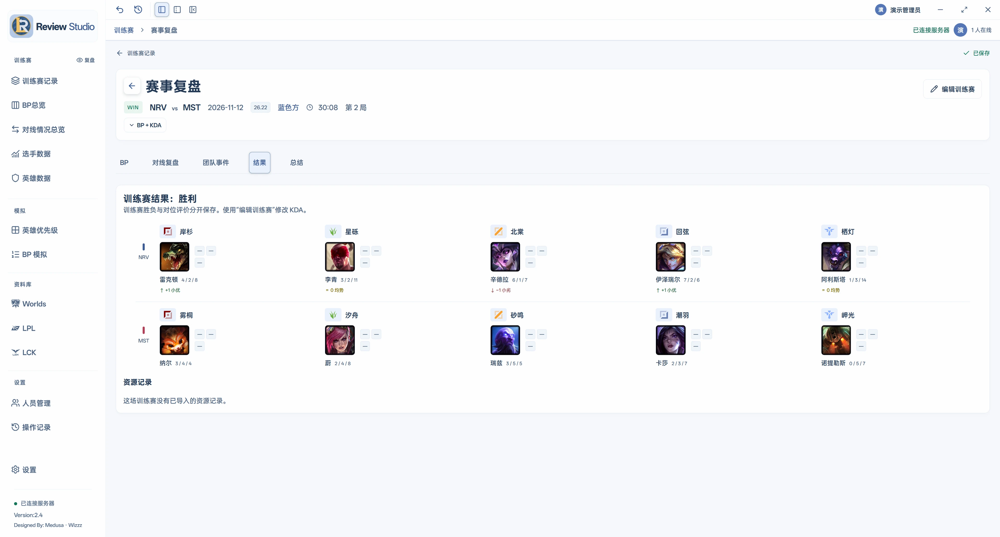](assets/guide/review-result.webp)

#### 总结

写下这局做得好的地方和下局要改的地方，保存后可以回来接着复盘。

<strong>总结页签</strong>（1 张截图）

[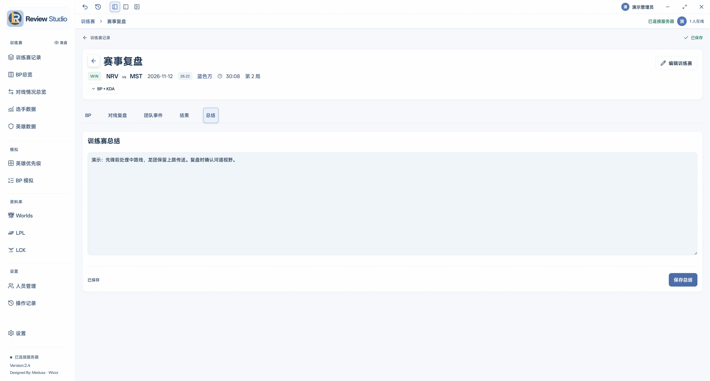](assets/guide/review-summary.webp)

#### 编辑训练赛

点复盘页右上角的「编辑训练赛」。这五步都在编辑同一局。

| 编辑页签 | 填写内容 |
| --- | --- |
| 基本信息 | 日期、赛季、版本、局数、对手、选边、比赛结果和时长。 |
| 双方阵容 | 按位置填写双方选手、英雄和 K/D/A。尚无击杀、死亡或助攻数据时可以留空。 |
| 召唤师技能与符文 | 为对局中的选手补录召唤师技能和基石符文。 |
| BP（可选） | 按实际出手顺序补录本局禁选。 |
| 确认保存 | 核对对阵和双方阵容，填写备注，再点「保存并复盘」。 |

<strong>完整编辑器的五个步骤</strong>（5 张截图）

**基本信息**

[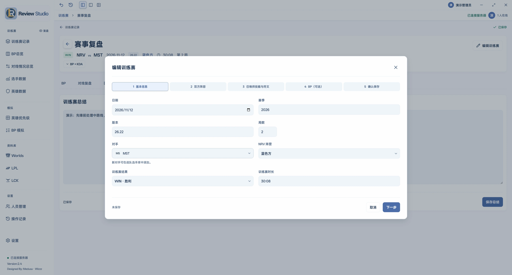](assets/guide/editor-basics.webp)

**双方阵容**

[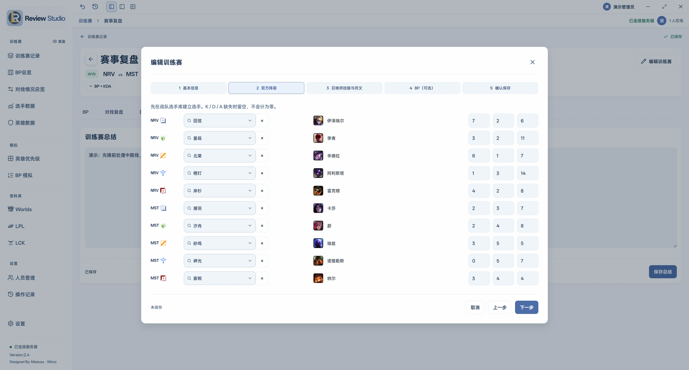](assets/guide/editor-roster.webp)

**召唤师技能与符文**

[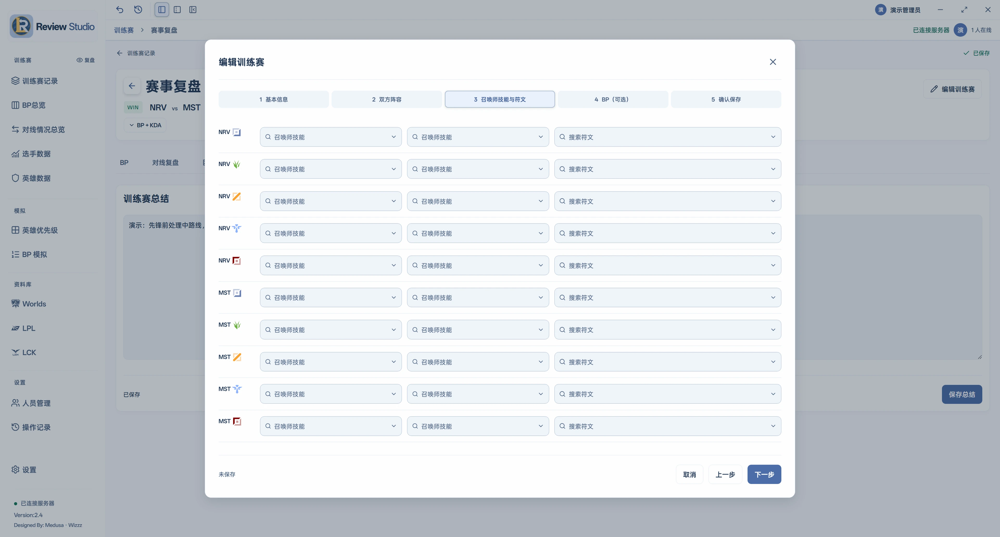](assets/guide/editor-spells.webp)

**BP（可选）**

[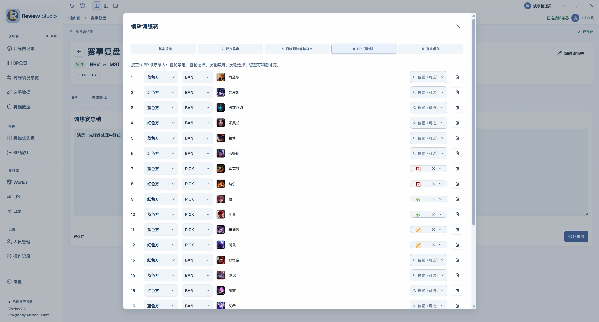](assets/guide/editor-bp.webp)

**确认保存**

[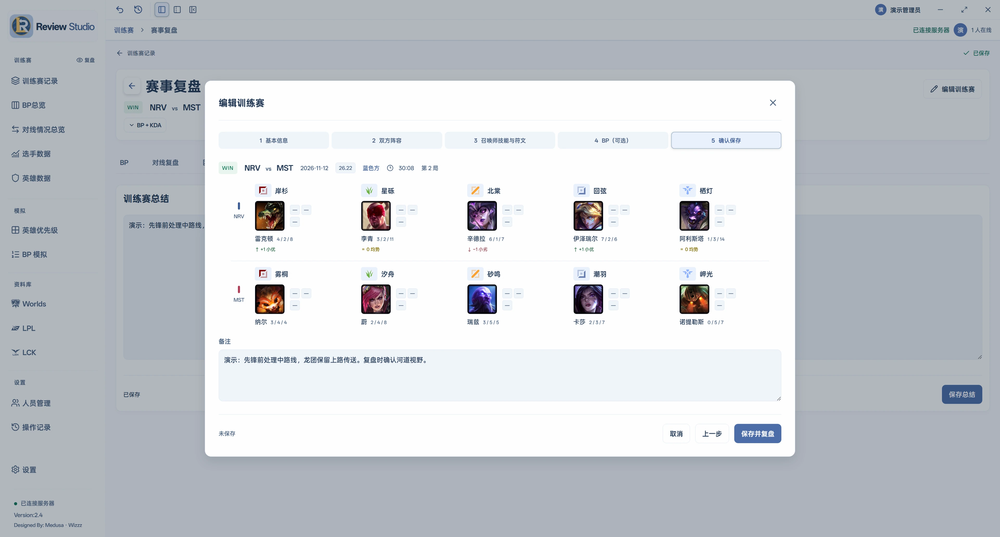](assets/guide/editor-confirm.webp)

[返回功能图览](#功能图览)

## 模拟

<picture>
  <source media="(prefers-reduced-motion: reduce) and (max-width: 640px)" srcset="assets/guide/draft-planning-compact-still.webp">
  <source media="(prefers-reduced-motion: reduce)" srcset="assets/guide/draft-planning-still.webp">
  <source media="(max-width: 640px)" srcset="assets/guide/draft-planning-compact.gif">
  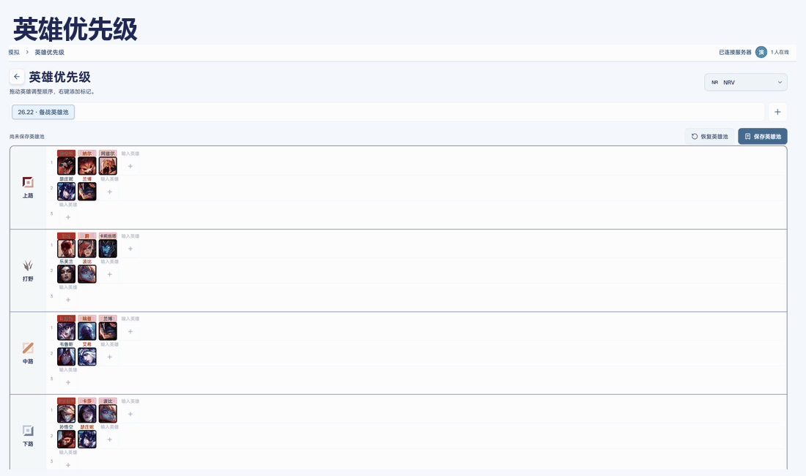
</picture>

[分路英雄池原图](assets/hero-priority.webp) · [两局 BP 模拟原图](assets/bp-simulator.webp)

### 英雄优先级

从「模拟 → 英雄优先级」选战队，按上、野、中、下、辅添加英雄。拖动可以改顺序，右键可标记优先级、我方绝活、敌方绝活或已使用。不同备战方案可以分开存，工作页能新增、改名或删除。点「保存英雄池」保存这页的阵容、顺序和标记。点「恢复英雄池」回到上次保存时的样子。

<strong>分路英雄池</strong>（1 张截图）

[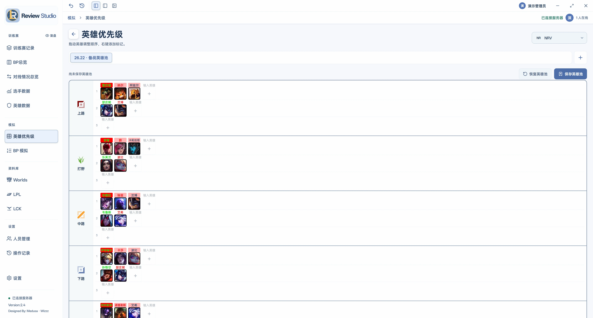](assets/hero-priority.webp)

### BP 模拟

一页可以放多局 BP，每局各自设置队伍、蓝红方和方案名。用全名或别名选英雄，再按禁选顺序排首选和备选。「BP 思路与备注」分两段，可以分别写前三个 Pick 和后两个 Pick 的预案。

拖选英雄格后，按 **Ctrl+C / Ctrl+V** 复制和粘贴选区。可从目标左上角跨阵营粘贴，粘贴时，选区里的空格也会覆盖目标。「批量粘贴」可以选要贴到哪一页、哪一盘。复制整盘时只复制 BP 格。打印前勾选要打的对局，一局一页。

<strong>BP 模拟</strong>（1 张截图）

[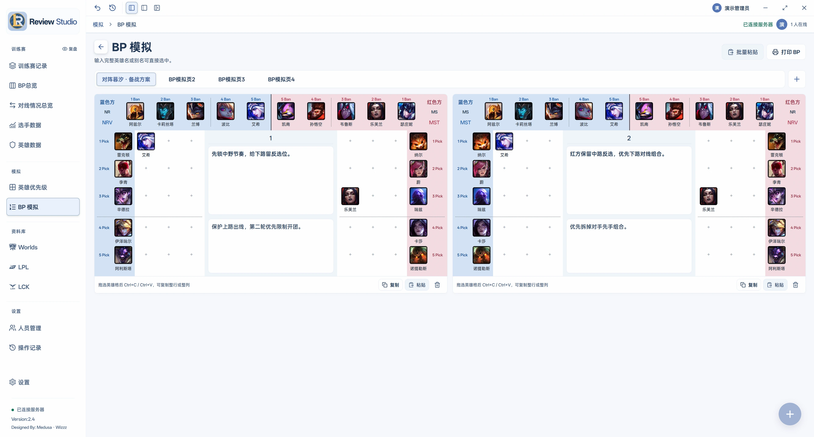](assets/bp-simulator.webp)

[返回功能图览](#功能图览)

## 资料库

<picture>
  <source media="(prefers-reduced-motion: reduce) and (max-width: 640px)" srcset="assets/guide/public-events-compact-still.webp">
  <source media="(prefers-reduced-motion: reduce)" srcset="assets/guide/public-events-still.webp">
  <source media="(max-width: 640px)" srcset="assets/guide/public-events-compact.gif">
  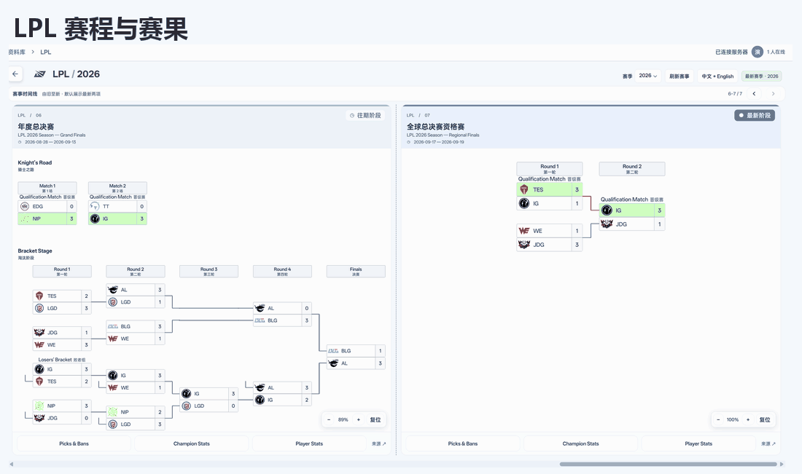
</picture>

[LPL 赛程原图](assets/lpl.webp) · [逐局禁选](assets/public-draft.webp) · [英雄统计](assets/public-champion-stats.webp)

### Worlds、LPL 与 LCK

| 资料库入口 | 在页面里看什么 |
| --- | --- |
| **Worlds** | 按赛季浏览全球总决赛各阶段，例如瑞士轮的战绩和淘汰赛的晋级路线。 |
| **LPL** | 沿赛事时间线查看已收录的联赛阶段与资格赛，在赛段卡片中看对阵、比分和晋级关系。 |
| **LCK** | 按赛季查看韩国联赛的阶段、赛程与赛果，在相应卡片打开该赛段的详细资料。 |

三个赛事入口都可以选赛季、切换往期和最新赛段、刷新资料和切换中英文。赛事图可以缩放、拖动或复位，点击战队看比赛历史。赛段卡片底部可打开已收录的禁选和统计页，收录多少局就显示多少局。

<strong>Worlds、LPL 与 LCK</strong>（3 张截图）

**Worlds**

[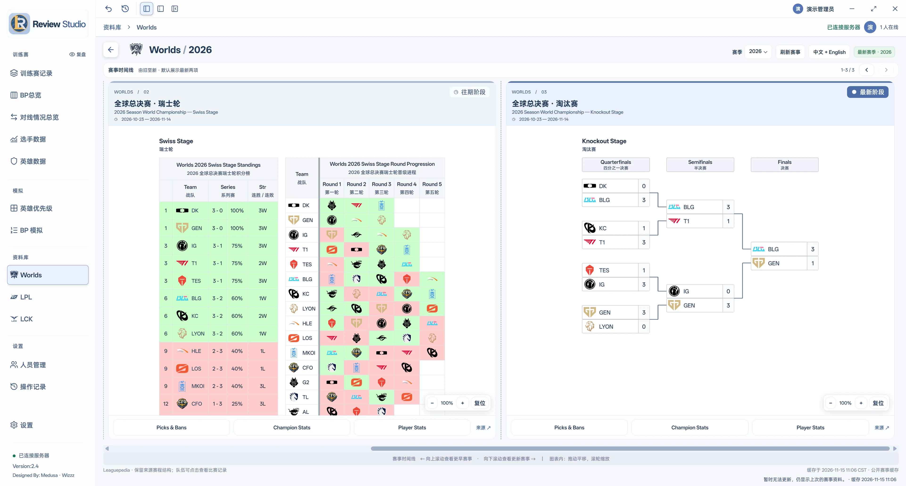](assets/worlds.webp)

**LPL**

[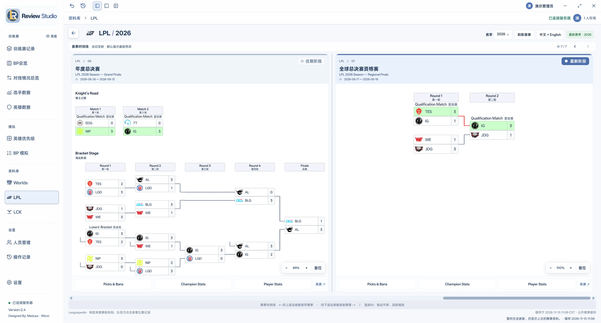](assets/lpl.webp)

**LCK**

[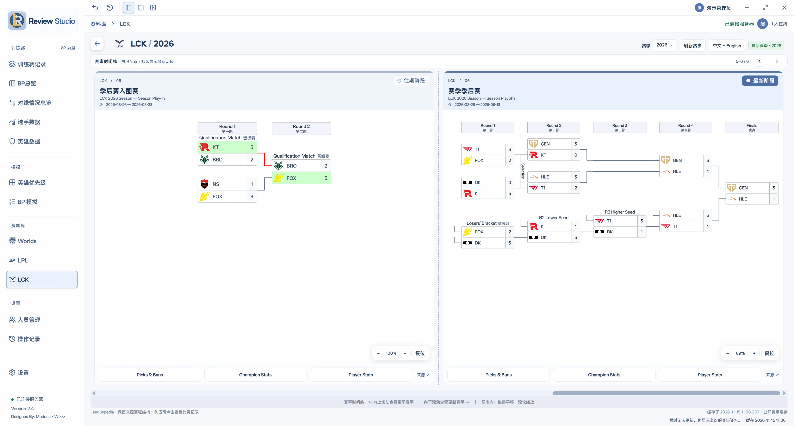](assets/lck.webp)

#### 公开赛事禁选与英雄统计

- **Picks & Bans · 常规展示** 按系列赛和局数查看蓝红双方禁选。可以筛选英雄和队伍，展开单局，或用「展开本页／收起本页」批量查看卡片。
- **Picks & Bans · 横向展示** 把多局放到一张表里，在「显示列」选要看的字段。高亮一个英雄，就能比较它在各局的禁选位置。
- **Champion Stats** 按赛段、队伍、位置、选手和英雄筛选。可以按场次、禁选率、胜负、KDA、经济或伤害比较英雄。点能打开的场次或选手看明细。

<strong>逐局禁选与英雄统计表</strong>（2 张截图）

**Picks & Bans**

[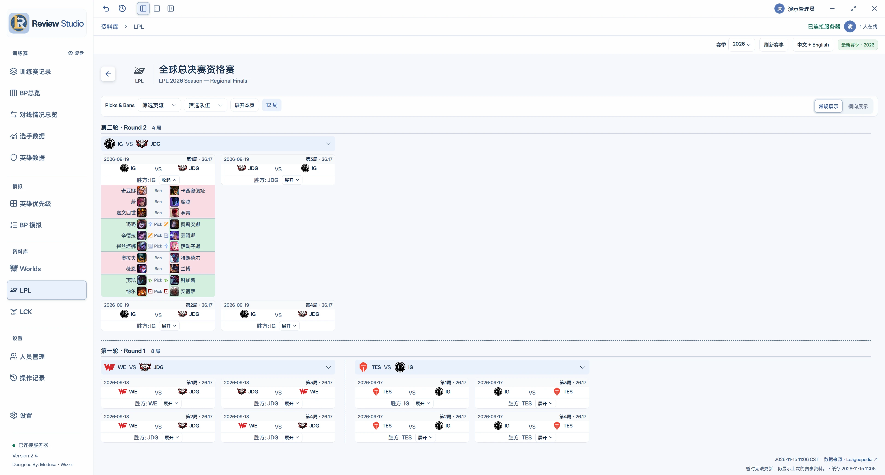](assets/public-draft.webp)

**Champion Stats**

[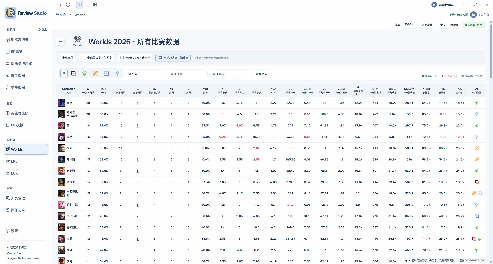](assets/public-champion-stats.webp)

[查看禁选动图](#禁选展开与横向切换) · [查看完整窗口原图](assets/guide/bp-display-full.webp)

#### Players 与逐局数据

| 页面或详情 | 可以做什么 |
| --- | --- |
| **Player Stats · 赛段选手统计** | 从 Worlds、LPL 或 LCK 的赛段卡片进去，按位置、队伍和选手筛选有完整计分板的对局。可以比较场次、胜率、KDA、补刀、视野、经济、伤害、参团率和英雄数。点 **G（场次）** 看该选手在当前范围内的逐局记录。 |
| **Players · 公开选手资料** | 公开选手资料可按选手、位置和赛事筛选。职业赛事的分段统计可从赛段卡片打开，团队训练赛则使用侧栏「选手数据」。 |
| **选手全年英雄统计** | 在比赛历史里，点有逐局资料的选手，就能看到他这一赛季用过哪些英雄、出场次数和胜率。还可以按赛事和赛段筛选。 |
| **逐局详情与 By 明细** | 在逐局表里查看日期、版本、选边、对位英雄、阵容、技能和装备等已收录字段。英雄统计的 **By** 可查看使用该英雄的选手。从可点击的选手 ID 可继续看同一赛事范围内的对局。 |

<strong>赛段 Player Stats、Players 和逐局详情</strong>（3 张截图）

**赛段 Player Stats**

[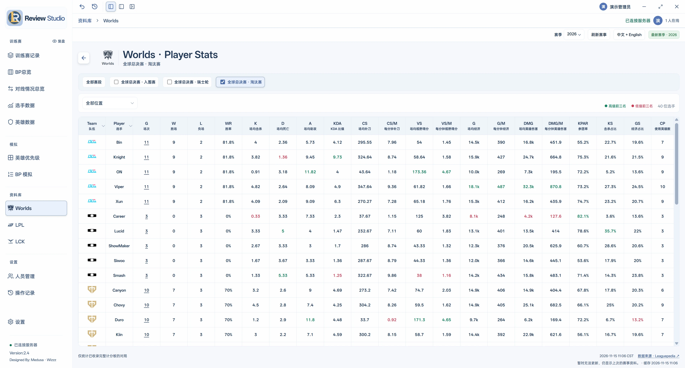](assets/guide/event-player-stats.webp)

**Players**

[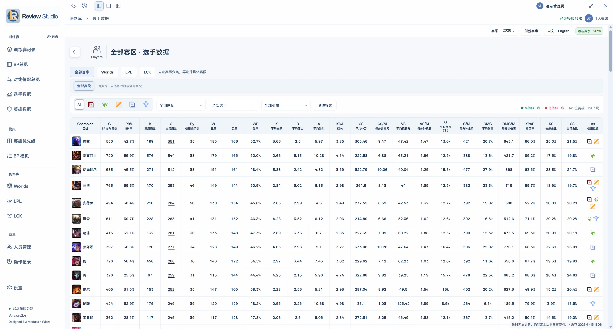](assets/players.webp)

**逐局详情**

[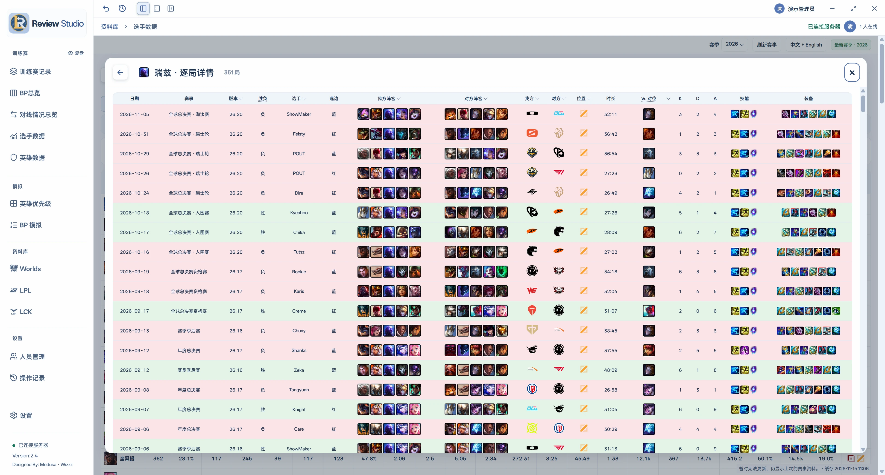](assets/public-player-games.webp)

#### 战队比赛历史

在赛程或禁选页点战队，就能打开该队的「比赛历史」。表格分「基本信息」「英雄」「当局选手」三组。按日期、版本、胜负、选边和对手找对局，再看双方 Ban、Pick 和阵容。可用「当局选手」表头切换整表的本方或对方阵容，鼠标移到英雄上，这一页的同名英雄会一起高亮。

<strong>战队比赛历史</strong>（1 张截图）

[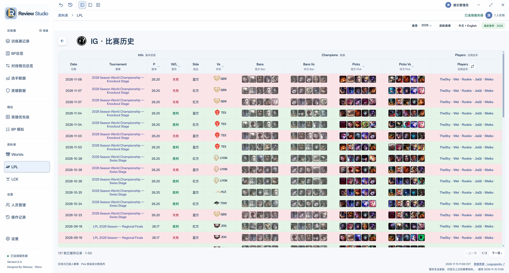](assets/guide/team-history.webp)

[返回功能图览](#功能图览)

## 设置

### 设置页

从侧栏底部的齿轮进入。

#### 登录与加入团队

在「设置 → 个人信息」登录，或注册后选择要加入的团队。提交申请后可以看审批状态。通过后，按权限使用团队训练赛、BP 和统计。没登录也能查公共资料。

#### 个人信息与界面外观

| 入口或栏目 | 可以做什么 |
| --- | --- |
| **个人信息** | 登录后可以改显示名称、头像和密码，也可以退出登录。上传图片后，用拖动和缩放来裁切头像。也可直接点击标题栏头像或用户名。 |
| **界面主题与字体** | 可选经典蓝、雾港蓝、夜航蓝，并在 400、500、600、700 四档间调整字重。主题选好就会生效，下次打开也会保留。 |
| **页面与表格** | 选择等比缩放或原尺寸、固定或手动侧栏宽度、滚动停止后显示表头或一直显示。可设重新进入页面时每次重置、离开 30 秒后重置或在本窗口保留，并选择赛事图按内容宽度适配或使用原有布局。 |
| **团队工作空间与团队数据** | 查看当前所在的空间。软件管理员可在获授权的团队与公共资料间切换。在线团队数据按账号权限从服务器读取。断线且有未提交编辑时，可从同步提示导出未提交的修改。 |

<a href="assets/appearance.webp">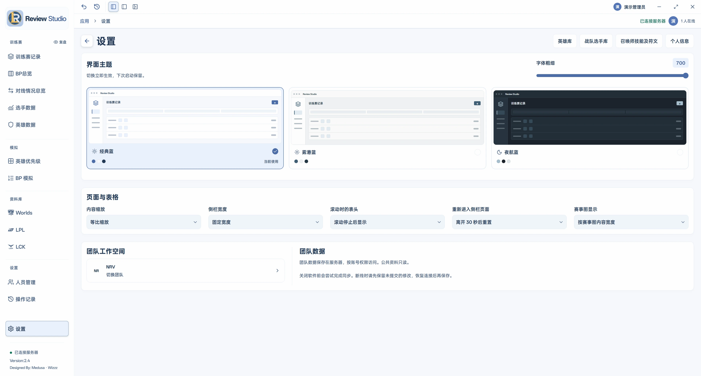</a>

<strong>登录与个人信息弹窗</strong>（2 张截图）

**登录**

[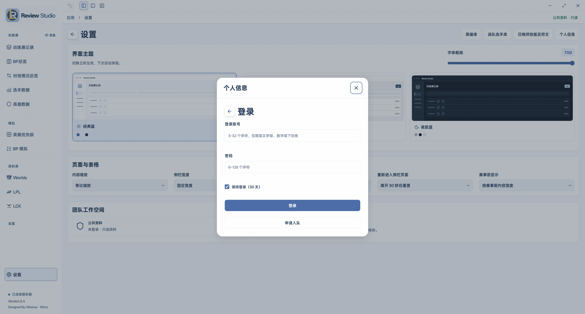](assets/sign-in.webp)

**个人信息**

[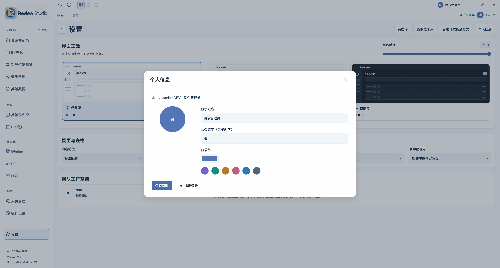](assets/account.webp)

#### 基础资料库

在线版从「设置」右上方进入这三页。资料由有相应权限的管理员维护。

| 页面 | 栏目与操作 |
| --- | --- |
| **英雄库** | 按分路或中文、英文、韩文、拼音、首字母、昵称搜索。悬停英雄头像可看最近训练赛表现。有权限时可维护英雄资料和别名，供训练赛与 BP 录入时匹配。 |
| **战队选手库** | 在「战队」按赛区选队，再查该队各位置的选手。管理员可维护战队名称、简称、队标，以及选手姓名、头像和一个或多个位置。 |
| **召唤师技能及符文** | 「召唤师技能」和「基石符文」分开展示名称与图标。有权限时可新增条目，双击卡片编辑标准名称、别名和图标。 |

<a href="assets/champion-library.webp">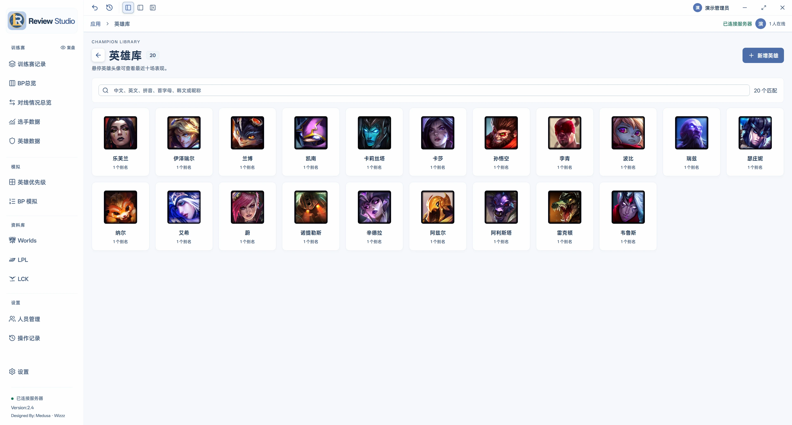</a>

<strong>战队选手库与技能符文</strong>（2 张截图）

**战队选手库**

[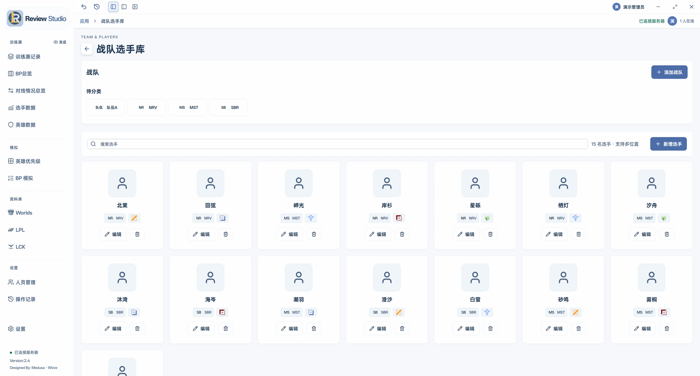](assets/team-roster.webp)

**召唤师技能及符文**

[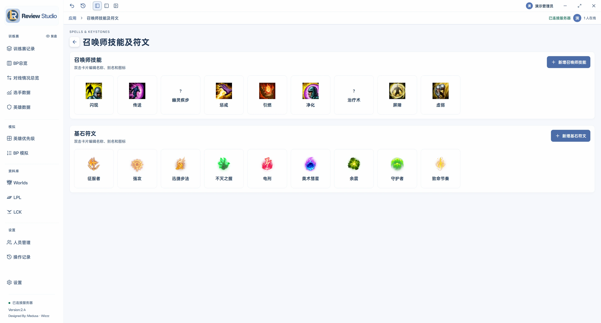](assets/spells-runes.webp)

### 人员管理

#### 全部成员

团队管理员能看本队，软件管理员能看所有团队。按姓名、账号或战队找成员，可以查看角色、是否启用和是否在线。软件管理员还可以创建用户、查看权限管理记录。

#### 入队申请

管理员可以看有哪些申请待审批、申请人想加入哪个队，再选择批准或拒绝。

<strong>成员列表与入队申请</strong>（2 张截图）

**全部成员**

[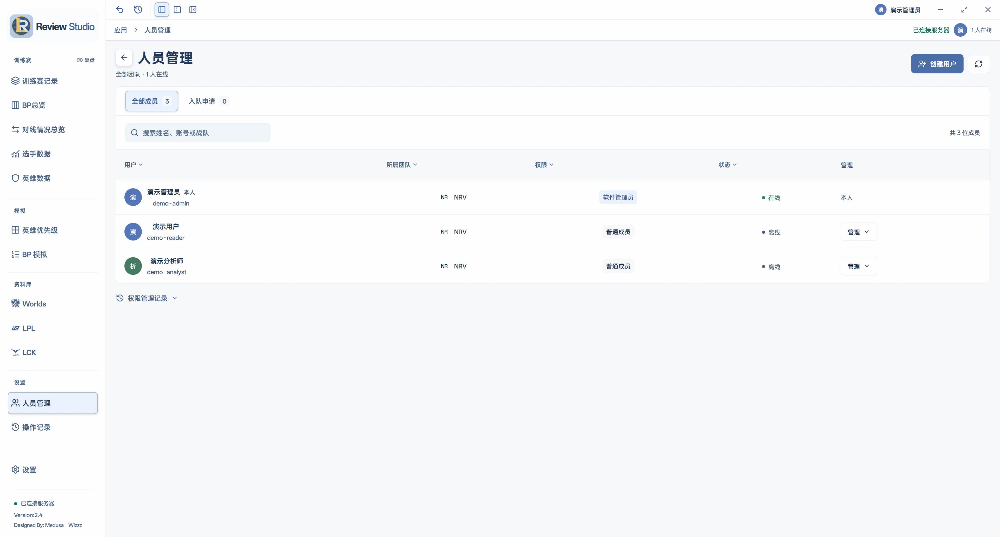](assets/team-members.webp)

**入队申请**

[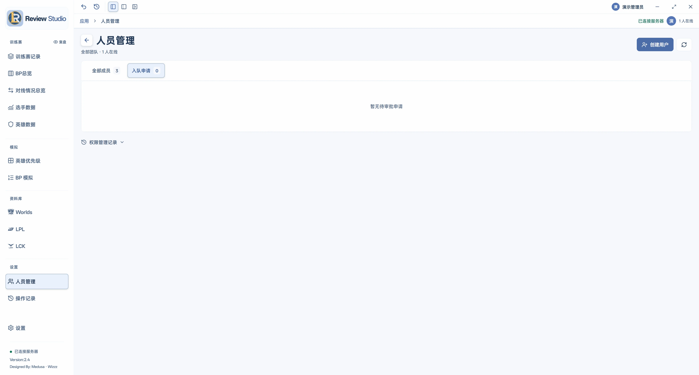](assets/guide/member-requests.webp)

### 操作记录

管理员按权限查看谁在什么时候改了什么。点「展开快照」看当时的内容，点「查看对照」看改动前后。能恢复的记录会显示「恢复」，遇到后续编辑冲突时保留当前内容。删除记录只会删这条日志。

登录后，点标题栏的「撤回自己的修改」，可以撤回自己在当前页的编辑。管理员可从「编辑记录」进入操作记录。顶部会显示正在同步、正在重连或连接中断。点待审批提醒，可以直接打开人员管理。

<strong>操作记录</strong>（1 张截图）

[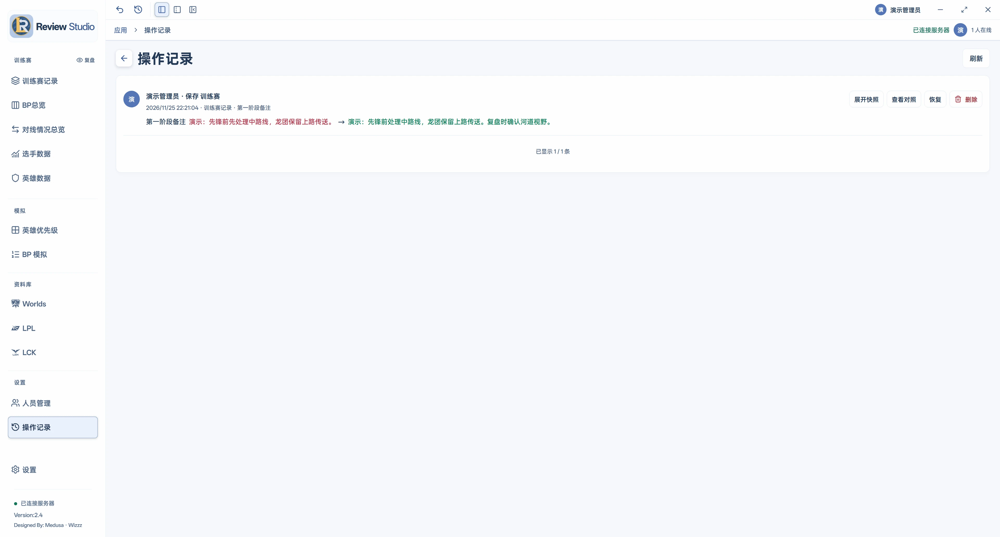](assets/history.webp)

[返回功能图览](#功能图览)

## 窗口操作

在标题栏切换完整侧栏、仅图标或隐藏侧栏。点左上角的返回按钮，或按鼠标后退侧键，都能回到上一层。从逐局详情返回时，筛选结果会保留。

### 独立页面窗口

右键侧栏入口，选「在新窗口打开」。这样可以在主窗口复盘，同时用另一个窗口看选手的对位和英雄表现。两个窗口可以各自切页。

<strong>右键入口与独立窗口</strong>（2 张截图）

**右键侧栏入口**

[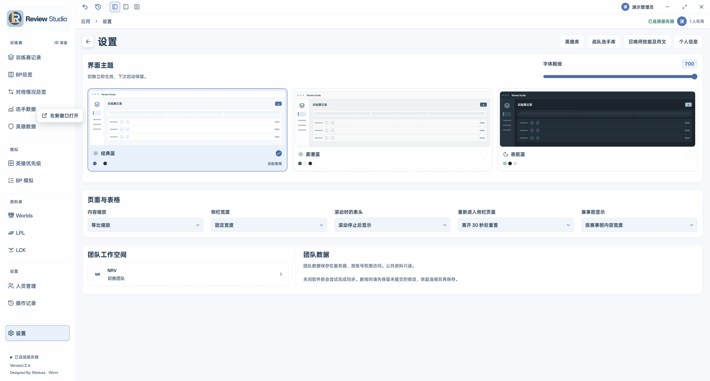](assets/page-window.webp)

**独立窗口**

[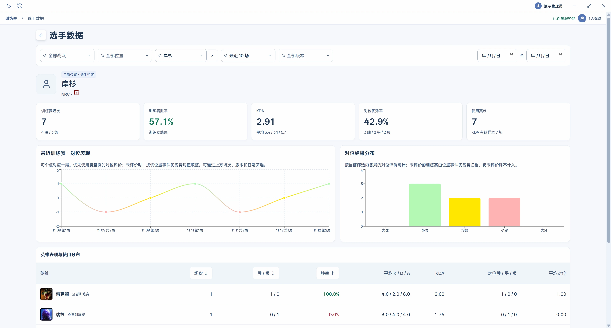](assets/detached-stats.webp)

## 交互动效

<a href="assets/guide/ui-button.gif"><picture>
  <source media="(prefers-reduced-motion: reduce)" srcset="assets/guide/ui-button-still.webp">
  
</picture></a>
<a href="assets/guide/ui-hover.gif"><picture>
  <source media="(prefers-reduced-motion: reduce)" srcset="assets/guide/ui-hover-still.webp">
  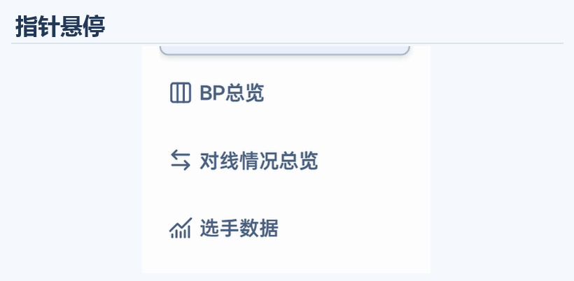
</picture></a>
<a href="assets/guide/ui-navigation.gif"><picture>
  <source media="(prefers-reduced-motion: reduce)" srcset="assets/guide/ui-navigation-still.webp">
  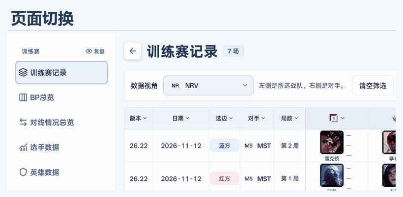
</picture></a>
<a href="assets/guide/ui-tabs.gif"><picture>
  <source media="(prefers-reduced-motion: reduce)" srcset="assets/guide/ui-tabs-still.webp">
  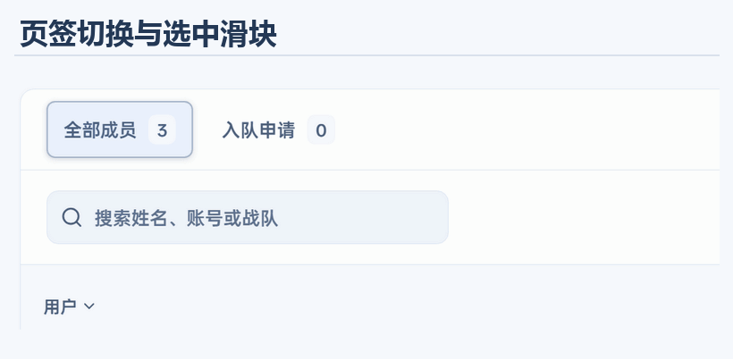
</picture></a>
<a href="assets/guide/ui-sidebar.gif"><picture>
  <source media="(prefers-reduced-motion: reduce)" srcset="assets/guide/ui-sidebar-still.webp">
  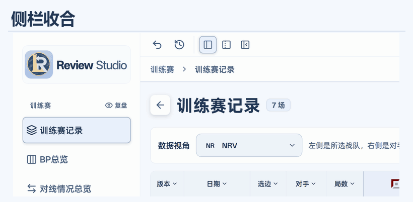
</picture></a>
<a href="assets/guide/ui-slider.gif"><picture>
  <source media="(prefers-reduced-motion: reduce)" srcset="assets/guide/ui-slider-still.webp">
  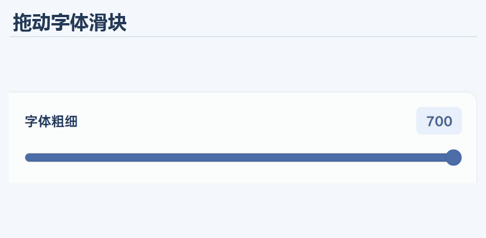
</picture></a>

### 禁选展开与横向切换

<picture>
  <source media="(prefers-reduced-motion: reduce) and (max-width: 640px)" srcset="assets/guide/bp-display-compact-still.webp">
  <source media="(prefers-reduced-motion: reduce)" srcset="assets/guide/bp-display-still.webp">
  <source media="(max-width: 640px)" srcset="assets/guide/bp-display-compact.gif">
  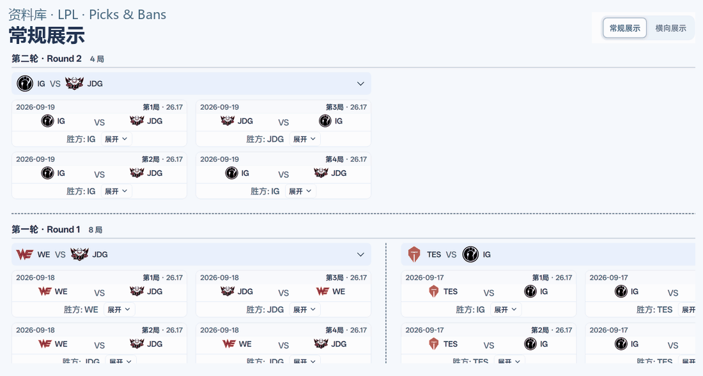
</picture>

## 安装与使用

1. 使用 Windows x64。在[正式版发布页](https://github.com/LOLDataStudio/review-studio-downloads/releases/latest)的 **Assets** 下载 `ReviewStudio-Formal-2.5-Online-20261126.exe` 并运行安装。
2. 第一次打开需要联网。没登录也可以查看公开赛事。登录并加入团队后，能按权限查看或编辑该队的训练赛、BP 和统计。

## 数据与升级

升级前先退出软件，备份本机数据。覆盖安装时选原正式版的目录，这样会保留数据和配置。历次升级说明见更新日志。 [正式版更新日志](CHANGELOG.md)
